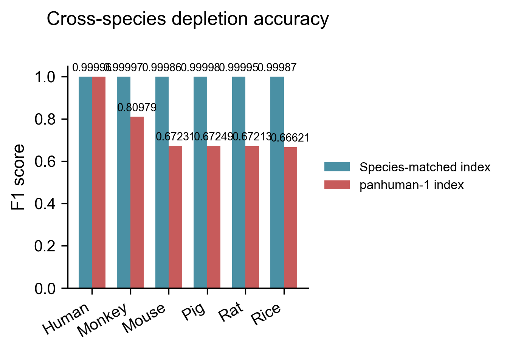
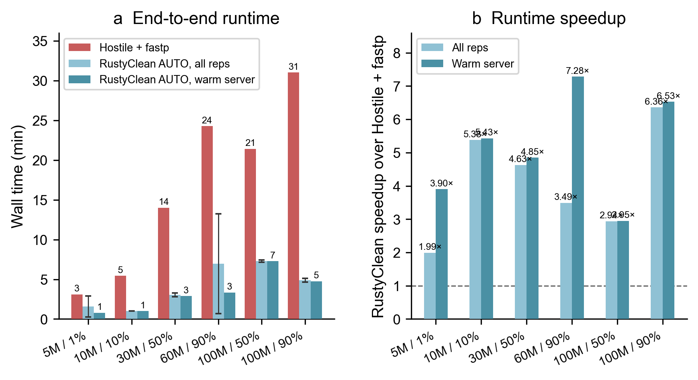

**Yufeng Zhang^1^, Jing-Yi Zhang^1^ and Shi Huang^1,\*^**

^1^Faculty of Dentistry, The University of Hong Kong, Hong Kong SAR, China  
^\*^Correspondence: qdu_zyf@163.com

Running title: Adaptive host-read depletion  
Keywords: metagenomics; host DNA depletion; minimizers; Bowtie2; workflow orchestration; Rust

## Abstract

**Motivation:** Host depletion must balance loss of microbial signal against retention of host DNA. Rapid depletion filters are efficient but require quality control, verification and scalable orchestration.

**Results:** In a descriptive workflow-scope panel, RustyClean AUTO took 90–2397 s versus KneadData 420–8271 s. Conditional verification reduced host input retention from 0.0035–0.0037% to ≤0.0000105% with microbial loss ≤0.310%; retained-microbe F1 remained ≥0.998. Equal-thread analysis showed RustyClean faster in 12/18 pairs (median speedup 1.72×), without significant paired runtime evidence. Thresholds formed a broad 0.10–0.40 accuracy plateau. Cleanifier was microbial-sparing but retained 27-fold more host DNA, whereas a divergent-host mock panel confirmed lower RustyClean host retention. Species-matched indexes improved non-human depletion in the tested panel.

**Availability and implementation:** RustyClean is Rust software available under the MIT licence at https://github.com/HuangShiLab/rustyclean, with source data and analysis code at https://github.com/HuangShiLab/rustyclean-paper.

**Supplementary information:** Supplementary Figures S1–S3 and Tables S1–S8 accompany this article.

## 1 Introduction

Shotgun metagenomic sequencing of host-associated samples returns a mixture of microbial and host DNA. The host fraction varies widely among body sites: faecal samples are often only a few per cent human, whereas oral, skin and biopsy samples may exceed 50–90% host. Because residual host reads waste sequencing capacity and can distort profiling, assembly and metagenome-assembled genome recovery, computational depletion is generally applied before downstream analysis. The task can be viewed as binary classification at read level. A microbial read incorrectly classified as host is an irreversible false positive that removes biological signal; a host read incorrectly retained is a false negative that contaminates downstream analyses and has privacy implications when human sequence data are shared.

Existing tools make this trade-off in different ways. Alignment-based methods such as Bowtie2 (Langmead and Salzberg, 2012), BWA and KneadData (McIver et al., 2018) remove reads that align to a host reference, whereas k-mer classifiers such as Kraken2 (Wood et al., 2019) use database-backed assignments. In a broad benchmark across human and rice datasets, alignment-based methods tended to discard more microbial reads, whereas classifier-based methods retained more host reads; classification was substantially faster under high contamination (Gao et al., 2025). Hostile (Constantinides et al., 2023) improved the practical alignment trade-off by combining fast streaming with carefully constructed indexes, but its runtime still scales with the amount of sequence that must be aligned.

Deacon, a recently described minimizer-based sequence filter, uses a compact pangenome index and was reported to combine alignment-like accuracy with classification-like speed (Constantinides et al., 2025). Its per-read cost is approximately independent of host fraction. This property changes the design space: rather than routing samples between a fast classifier and a slower, more precise aligner, one fast depletion backend can be used across host fractions, and the remaining question is when a second verification pass is worth its cost. Deacon alone, however, is a sequence filter rather than a production pipeline. It does not perform read-quality control, orchestrate cohorts, checkpoint interrupted samples, validate final outputs or decide when residual host contamination warrants additional screening. Its published indexes also cover only human and mouse, leaving index construction and cross-species validation to users.

RustyClean addresses these gaps by integrating Deacon into a reproducible pipeline and adding conditional verification. RustyClean first applies fastp (Chen et al., 2018), then Deacon, and then Bowtie2 only when Deacon reports that at least a user-configurable fraction of input reads was removed (default 0.30). Thus, low-host samples avoid an unnecessary alignment pass, whereas high-host samples receive a second screen over a relatively small retained set. We evaluated this design on simulated metagenomes with per-read ground truth, compared the full pipeline with KneadData and Hostile, validated species-matched indexes for six host organisms, measured cohort-level parallel scaling and tested robustness on a small human oral microbiome cohort.

## 2 Materials and methods

### 2.1 Pipeline overview

RustyClean AUTO processes each sample through four stages: (i) quality control with fastp; (ii) minimizer-based depletion with Deacon against a user-supplied pangenome index; (iii) conditional Bowtie2 verification; and (iv) validation and finalisation. Single-end and paired-end FASTQ inputs are detected automatically. Samples may be supplied individually or as a manifest. The streamlined production interface exposes only the AUTO pipeline and a `--deacon-only` benchmarking mode; alternative backends used in earlier experiments are not part of the default workflow.

### 2.2 Quality control

Reads are processed with fastp (Chen et al., 2018) using automatic paired-end adapter detection, sliding-window trimming at both ends, a minimum base quality of Q20 and a minimum retained length of 50 bp. fastp reports are parsed into structured per-sample metrics containing input and output read counts, Q20/Q30 rates, GC content, adapter-trimmed reads and length- or quality-filtered reads. RustyClean does not perform tandem-repeat masking, which is supported by KneadData through Trimmomatic (Bolger et al., 2014) and Tandem Repeats Finder (Benson, 1999). This scope difference is retained in the interpretation of runtime comparisons.

### 2.3 Depletion and adaptive verification

Deacon v0.17.0 was used with a k31,w15 pangenome index and clean parameters `-d -a 2 -r 0.01`. For human samples, the default Tier-1 index was the published panhuman-1 pangenome index. RustyClean parses the Deacon summary and obtains the removed-read proportion, `seqs_removed_proportion`. If this value is at least the recheck threshold (default 0.30), the retained reads are screened with Bowtie2 v2.5.5 (Langmead and Salzberg, 2012) against the human T2T-CHM13v2.0 plus HLA index used by Hostile. For paired-end libraries, a fragment was retained only when both mates were unmapped (SAM flag 12 after Bowtie2); for single-end libraries, only unmapped reads were retained. Otherwise, the Deacon output was accepted without realignment. The pass can be disabled with `--no-bowtie2-recheck`.

Before promotion to the final output directory, validation checked that R1 and, when present, R2 outputs existed and exceeded 1024 bytes. It also calculated a diagnostic contamination metric as removed host reads divided by removed host reads plus retained reads, multiplied by 100. This diagnostic value was set to 100% in all benchmarked AUTO commands through `--max-contamination 100.0`, disabling rejection. It is therefore not an independently estimated residual-host fraction and must not be interpreted as output contamination. Failed samples remained visibly failed and were not consumed by downstream steps.

### 2.4 Orchestration

Each sample is represented by an ordered state machine and an atomically written versioned checkpoint. The checkpoint contains an xxHash3 fingerprint of input metadata; changing an input invalidates prior state. Samples can therefore resume after interruption without silently mixing results from different files. Concurrency is controlled at two levels: a counting semaphore admits *W* samples concurrently and each sample passes *T* threads to external tools. If worker count is not set, RustyClean estimates the resident index size and available memory, including cgroup limits, and caps *W* so that concurrent workers remain within approximately 80% of available RAM. RustyClean is a single Rust binary that calls fastp, Deacon, Bowtie2 and samtools.

### 2.5 Benchmark panel

Six single-end simulated metagenomes were generated with InSilicoSeq v2.0.0 (Gourlé et al., 2019) and per-read ground truth. The panel varied realized host fraction (0.9–91.4%), depth (5–100 million nominal reads), community complexity and abundance distribution (Table 1). RustyClean AUTO and standalone Deacon were compared descriptively with the full KneadData v0.12.3 pipeline and fastp plus Hostile. KneadData used its hg39_T2T Bowtie2 index (GCF_009914755.1, without HLA); Hostile used human-t2t-hla; RustyClean used panhuman-1 for Tier-1 depletion and the human-t2t-hla Bowtie2 index for verification. KneadData and Hostile + fastp were run with eight threads. Deacon and RustyClean were run with 16 threads. RustyClean timings used three replicates per condition; the AUTO 100M/90% estimate was the mean of two uncached replicates. KneadData and Hostile 100M comparator runs were single measurements because of cost. Wall-clock time and maximum resident set size were recorded with GNU time; max RSS is the largest measured process rather than process-tree memory. Depletion is deterministic, so accuracy was evaluated once per condition. A count-level audit of archived TP/FP/FN/TN tables is provided in `data/metric_audit/RAW_READ_METRIC_AUDIT.md`. For the 5–60M Hostile cells, archived error counts derive from a Hostile-only raw-input arm (`hostile_raw`), whereas the displayed Hostile runtime derives from separate fastp + Hostile timing; the 100M Hostile error and runtime derive from the later fastp + Hostile fill run. The 100M comparator file contains summary rates but not archived TP/FP/FN/TN counts. Table 2 is therefore a descriptive historical summary and is not the primary controlled comparator; the controlled Hostile runtime and accuracy comparison is the equal-thread panel in Section 3.4.

**Table 1.** Simulated datasets used for the main comparison.

| Dataset | Reads (M) | Host (%) | Complexity | Abundance | Layout |
|---|---:|---:|---|---|---|
| 5M / 1% | 5.0 | 0.9 | low | even | single-end |
| 10M / 10% | 9.5 | 10.0 | medium | even | single-end |
| 30M / 50% | 23.9 | 59.7 | high | skewed | single-end |
| 60M / 90% | 56.2 | 91.4 | high | lognormal | single-end |
| 100M / 50% | 87.8 | 54.1 | high | lognormal | single-end |
| 100M / 90% | 93.6 | 91.4 | high | lognormal | single-end |

### 2.6 Accuracy and performance metrics

For main-panel and cross-species outputs, TP denotes a retained true microbial read, FP a retained true host read, FN a discarded true microbial read and TN a removed true host read. Microbial loss was FN/(TP+FN), expressed as a percentage of true microbial input. Host input retention was FP/(FP+TN), expressed as a percentage of true host input. Host output fraction was FP/(TP+FP), expressed as a percentage of retained reads. F1 used retained microbial reads as the positive class. Thus host input retention and host output fraction are distinct denominators and are not interchangeable. Runtime was sample-level wall time for individual libraries or cohort wall time for parallel batches. Peak memory was largest-process maximum resident set size and is reported in GiB unless stated otherwise; process-tree memory was not measured. In the archived supplementary backend comparison, TP instead denotes a removed host read, FP a lost microbial read, FN a retained host read and TN a retained microbial read; its biological error rates were recomputed with the same host-input and microbial-input denominators.

### 2.7 Cross-species and parallel-scaling experiments

Species-specific Deacon indexes (k31,w15) were built for human T2T-CHM13v2.0, monkey, mouse, pig, rat and rice. Taxids and source FASTA basenames are preserved in `cross_species/host_reference_provenance.csv`; original NCBI accession, assembly version and strain provenance were not retained in the surviving benchmark artifact. Index build time and size were recorded. Ten-million-read, 50%-host simulated datasets for each species were depleted with either the matched index or panhuman-1. To assess cohort scaling, sixteen identical 10M-read single-end libraries (10% host) were processed as a manifest with four threads per sample and *W*=1, 2, 4 or 8 concurrent workers on one 64-core AMD node. Because this condition was below the verification threshold, each sample ran fastp and Deacon but not Bowtie2. Deacon processes were sampled every 5 s to record resident set size. This scaling experiment was not replicated and used identical low-host libraries that did not trigger verification. Tool versions and exact benchmark parameters are provided in `source_data/unresolved_controls/benchmark_parameter_manifest.yml`.

To compare full pipelines under batch conditions, twenty-four balanced 1M-read libraries spanning 1–90% host were processed with sixteen cores using either RustyClean AUTO or fastp plus Hostile. RustyClean used fastp gzip level 1, node-local scratch, a warm Deacon server and W=8 workers with two threads per worker; Hostile + fastp used eight independent per-sample pipelines with two threads each. The same 16-core budget was used for both tools.

### 2.8 Supplementary backend comparison

To place the default backend in context, we previously compared Bowtie2, minimap2 and Centrifuge within an earlier research build of RustyClean on four simulated datasets. Those experiments used the same orchestration concept but are not exposed by the streamlined production CLI. Results are shown in Supplementary Figure S1 and Table S1 and are retained as provenance rather than as a recommendation.

### 2.9 Equal-thread, comparator, threshold and mock-truth controls

Five review-responsive controls were added after review. First, RustyClean AUTO and sequential fastp plus Hostile were rerun on all six simulated libraries with three replicates each on exclusive Intel partition nodes; each task was allocated 16 CPUs and both arms launched nominal 16 primary worker threads. The arms used the same input and indexes, warm caches, fastp gzip level 1 and node-local scratch. Wall time was measured with GNU time; the Hostile arm was the sum of its two sequential stages. Job IDs, node assignments, start and end times are in `equal_thread_run_manifest.csv`. An initial non-exclusive AMD array was retained as a resource-contention sensitivity dataset because jobs could share nodes; it was not pooled with the primary analysis. Second, Cleanifier v1.3.2 (Zentgraf et al., 2025) was run with its downloaded human T2T-pangenome/HLA/cDNA spaced-seed index, default score threshold 0.5, 16 worker threads, two compression threads and gzip level 1 on the same six libraries; index download was not timed. Third, the Bowtie2 verification threshold was swept over 0.00, 0.05, 0.10, 0.15, 0.20, 0.25, 0.30, 0.35, 0.40, 0.50, 0.60, 0.80 and 1.01 across all six libraries. Because per-read classification was deterministic, each threshold used one accuracy observation; runtime medians are descriptive and are not used for threshold selection. Fourth, unconditional verification (threshold 0.00) was run with three replicates and compared with the archived no-recheck control (threshold 1.01). Finally, a mock ground-truth panel used a synthetic divergent chromosome-1 host derived from GRCh38 by seeded 1% substitutions, five GTDB microbial genomes and three independent seeds. Each replicate contained two million 150-bp paired fragments with 20% host; synthetic read names guaranteed exact per-fragment truth. This stress test is not a substitute for a population-scale real cohort and the simulated FASTA reads used a transparent uniform substitution model rather than a published ART error profile. All new accuracy tables were recomputed from retained-read IDs with TP = retained microbe, FP = retained host, FN = lost microbe and TN = removed host. Paired runtime tests were two-sided; sign tests, paired t-tests, Wilcoxon signed-rank tests, dataset-level tests and 100 000-replicate cluster bootstraps were calculated with SciPy 1.18.0 in Python 3.12.12. The equal-thread control used RustyClean 0.1.0, fastp 1.0.1, Hostile 2.0.2, Bowtie2 2.5.5, samtools 1.24 and Deacon 0.17.0.

To compare real production index formats, Deacon v0.17.0 and Cleanifier v1.3.2 were each run on the full FASTQs from all six simulated libraries, three replicates per dataset, with 16 threads and their released production indexes. GNU time recorded runtime and largest-process RSS. Retained-read IDs were counted against per-read truth as above.

To test whether minimizer and gapped-seed evidence are complementary, we also evaluated a post-hoc RustyClean-X consensus on the same runs. A read was retained only if it was retained by both Deacon and Cleanifier; equivalently, either production arm could deplete it. This union-depletion rule is a deliberately conservative privacy setting of the planned dual-evidence classifier and is not the optimized one-pass RustyClean-X implementation. Consensus runtime is therefore the sum of the two sequential arms and is reported only as a post-processing evidence benchmark, not as software runtime. Accuracy was recomputed from read IDs with microbial retained reads, host retained reads, host removed reads, microbial removed reads, host retention, host removal, microbial loss, output host fraction, precision, recall and F1.

## 3 Results

### 3.1 Runtime, memory and read-level accuracy

Because Deacon’s cost is approximately independent of host fraction, RustyClean AUTO used the same depletion backend for all six datasets; only verification varied. Table 2 is a descriptive historical workflow-scope comparison and is explicitly not a controlled speed benchmark or the primary comparator evidence. Deacon/AUTO used 16 threads, KneadData/Hostile used 8 threads, KneadData performed additional trimming, repeat masking and identifier reformatting, and comparator provenance is mixed as described below. Within that panel, AUTO required 90.4–2396.7 s versus 420.3–8271.0 s for KneadData (3.45–10.19-fold). Under default serialization, AUTO was 1.35–2.30-fold faster than fastp plus Hostile on the 5–60M datasets but 1.29–1.31-fold slower on the two 100M datasets because its conditional Bowtie2 pass fired. Standalone Deacon depletion, which excludes fastp and verification, required only 9.6–202.4 s and was 40.9–130.2-fold faster than complete KneadData; this depletion-only/full-pipeline comparison must not be read as a like-for-like speed ratio.

Reducing serialization overhead reversed the 100M runtime penalty. In a same-node, cache-warmed paired validation on 100M/90% data, optimized RustyClean completed in 428 ± 76 s (mean ± SD, n = 3) versus 1032 ± 37 s for fastp plus Hostile. RustyClean was faster in all three replicates (2.12×, 2.26× and 3.01×; paired t-test p = 0.006) and retained F1 = 0.998408 versus 0.990647 for Hostile. Across the six-dataset optimized panel, all-replicate speedups versus historical Hostile measurements were 1.99–6.36×; these runs were unpaired except at 100M/90% and warm-server values were not mixed into this range (Supplementary Fig. S2).

{width=100%}

**Table 2.** Historical four-tool comparison on the simulated workflow-scope panel. This table is descriptive and is not the primary controlled comparator or speed evidence; the primary controlled Hostile runtime comparison is Supplementary Table S4. Accuracy is deterministic and was evaluated once per dataset. F1 values are rounded to five decimals; exact comparator TP/FP/FN/TN values are in `data/metric_audit/`. Runtime and memory for RustyClean/Deacon are means of timing replicates; 100M KneadData and Hostile + fastp runs are single measurements. Host input retention is retained true host reads divided by true host input, not by retained output. Hostile error provenance differs between 5–60M and 100M cells, and archived 100M comparator counts are absent, as described in Methods. Exact AUTO retained-host counts were 2, 35, 0, 5, 1 and 9 for the six datasets in the order shown; zero denotes a true zero count.

| Dataset | Tool | Runtime (s) | Memory (GiB) | F1 | Microbial loss (%) | Host input retention (%) |
|---|---|---:|---:|---:|---:|---:|
| 5M / 1% | KneadData^b^ | 420.3 | 1.09 | 0.97981 | 3.956 | 0.2688 |
| 5M / 1% | Hostile + fastp^a^ | 186.6 | 3.38 | 0.99997 | 0.000 | 0.6858 |
| 5M / 1% | Deacon only | 9.6 | 4.54 | 1.00000 | 0.000 | 0.0042 |
| 5M / 1% | RustyClean AUTO | 90.4 | 4.54 | 1.00000 | 0.000 | 0.0042 |
| 10M / 10% | KneadData^b^ | 694.5 | 1.11 | 0.98571 | 2.791 | 0.2555 |
| 10M / 10% | Hostile + fastp^a^ | 326.5 | 3.55 | 0.99923 | 0.079 | 0.6745 |
| 10M / 10% | Deacon only | 13.0 | 4.54 | 0.99881 | 0.238 | 0.0037 |
| 10M / 10% | RustyClean AUTO | 142.0 | 4.54 | 0.99881 | 0.238 | 0.0037 |
| 30M / 50% | KneadData^b^ | 2317.5 | 1.11 | 0.99098 | 1.425 | 0.2500 |
| 30M / 50% | Hostile + fastp^a^ | 840.3 | 3.58 | 0.99501 | 0.000 | 0.6758 |
| 30M / 50% | Deacon only | 28.6 | 4.54 | 0.99997 | 0.000021 | 0.0037 |
| 30M / 50% | RustyClean AUTO | 622.3 | 4.54 | 1.00000 | 0.000343 | 0 (0 reads) |
| 60M / 90% | KneadData^b^ | 6822.0 | 1.11 | 0.97603 | 2.154 | 0.2496 |
| 60M / 90% | Hostile + fastp^a^ | 1456.4 | 3.60 | 0.96522 | 0.039 | 0.6745 |
| 60M / 90% | Deacon only | 52.4 | 4.54 | 0.99921 | 0.120 | 0.0036 |
| 60M / 90% | RustyClean AUTO | 669.5 | 4.54 | 0.99845 | 0.309 | 0.0000 |
| 100M / 50% | KneadData^b^ | 6419.0 | 1.10 | 0.98766 | 2.151 | 0.2493 |
| 100M / 50% | Hostile + fastp^a^ | 1284.9 | 3.60 | 0.99878 | 0.039 | 0.1734 |
| 100M / 50% | Deacon only | 153.4 | 4.54 | 0.99937 | 0.121 | 0.0035 |
| 100M / 50% | RustyClean AUTO | 1684.9 | 4.54 | 0.99845 | 0.310 | 0.0000 |
| 100M / 90% | KneadData^b^ | 8271.0 | 1.10 | 0.97603 | 2.153 | 0.2496 |
| 100M / 90% | Hostile + fastp^a^ | 1860.7 | 3.56 | 0.99065 | 0.039 | 0.1740 |
| 100M / 90% | Deacon only | 202.4 | 4.54 | 0.99920 | 0.120 | 0.0037 |
| 100M / 90% | RustyClean AUTO | 2396.7 | 4.54 | 0.99846 | 0.307 | 0.0000 |

^a^Hostile + fastp rows are descriptive. For 5–60M datasets, accuracy derives from a separate `hostile_raw` arm and runtime from separate `fastp + Hostile` timing. For 100M datasets, accuracy/runtime derive from a later `fastp + Hostile` fill run but archived TP/FP/FN/TN counts are absent.

^b^KneadData rows used an unequal thread count, unequal workflow scope and a different host index. Archived 100M KneadData TP/FP/FN/TN counts are absent.

Deacon-only runtime is a backend ablation rather than a competitor to the complete workflow. RustyClean necessarily spends additional time on fastp QC, orchestration, serialization, checkpointing and optional Bowtie2 verification. The relevant controlled question is therefore not whether AUTO matches Deacon, but whether the complete workflow is faster and more accurate than an external full pipeline under equal resources. No significance test is inferred from this historical panel; controlled runtime inference is shown in Section 3.4.

AUTO always had higher retained-microbe F1 than KneadData and matched or exceeded Hostile on four of six datasets (Fig. 2a). Hostile was marginally better on 10M/10% and 100M/50%, whereas AUTO was better on the other four datasets. AUTO microbial loss was at most 0.310% and was 7–12-fold lower than KneadData when loss was nonzero; KneadData lost 1.4–4.0% of microbial input. The step responsible within KneadData was not measured, so this difference should not be attributed solely to trimming or masking.

F1 alone therefore does not capture the primary design goal. Hostile can match or exceed AUTO on F1 while retaining far more host DNA because it loses fewer microbial reads. In the controlled equal-thread panel (Section 3.4), the RustyClean-versus-Hostile F1 difference was not significant, but AUTO retained 135-fold less host input on dataset means (paired *t*-test *p* = 1.7 × 10^-7^) and lost 6.1-fold more microbial input (*p* = 0.031). This is the intended trade-off rather than a failure of the integrated pipeline.

Verification changed the host-retention endpoint, not a single scalar notion of accuracy. Deacon alone retained 0.0035–0.0037% of true host reads. On the four high-host datasets that crossed the 0.30 threshold, Bowtie2 verification reduced retained host reads to 0, 5, 1 and 9 reads—respectively 0, 0.0000097%, 0.0000021% and 0.0000105% of true host input (Fig. 2b,c). The cost was additional microbial loss: compared with Deacon-only, AUTO lost 31 additional microbial reads on 30M/50%, 9158 on 60M/90%, 76257 on 100M/50% and, in the separate optimized 100M/90% run, 15098. This corresponds to 5.0, 45.4 and 4.7 additional microbial losses per extra host read removed on the latter three datasets. Retained-microbe F1 consequently decreased from 0.99921 to 0.99845, 0.99937 to 0.99845 and 0.99920 to 0.99846 on those three datasets. The 5M/1% and 10M/10% conditions fell below the threshold and retained the Deacon residue by design.

{width=100%}

Peak memory for AUTO was 4.54 GiB, similar to fastp + Hostile (3.38–3.60 GiB) and higher than KneadData (1.09–1.11 GiB), based on largest-process max RSS. This measure is not process-tree memory, so these values cannot establish workflow-level aggregate memory differences. Memory was determined mainly by the pangenome index and did not increase across 5–100M-read libraries. KneadData had the lowest reported single-process max RSS, but process-tree memory was not measured, so it should not be assumed to run within 1.1 GiB end-to-end. AUTO offered lower host input retention after verification within an index-bounded single-process footprint. The human T2T comparison is presented with the cross-species results in Section 3.2.

### 3.2 Species-matched indexes improved non-human depletion in a proof-of-concept panel

All species-matched Deacon indexes achieved F1 ≥0.99986 on 10M-read, 50%-host datasets (Fig. 3, Table 3). Matched-index microbial loss was 0.00182–0.02258% and host input retention was 0.00182–0.00596%. Index construction took 4–52 s. The smaller rice index occupied 0.30 GB, whereas mammalian indexes occupied 2.20–2.53 GB.

Applying the human panhuman-1 index to non-human libraries left 46.8% of monkey host reads and 97.0–99.8% of mouse, pig, rat and rice host reads in the output. This failed host removal, rather than microbial loss, explains the low precision and F1: panhuman-1 microbial loss remained only 0.0023–0.0027%. For human data, panhuman-1 reduced host input retention 45.7-fold relative to a T2T-only index (0.004931% versus 0.225369%). Thus minimizer depletion generalised in this proof of concept only with species-matched indexes; these results do not validate a universal pan-host index.

{width=100%}

**Table 3.** Cross-species host depletion with matched and human pangenome indexes. Rates are percentages of the respective true input class and derive from retained-microbe confusion matrices.

| Host | Matched index | Matched F1 | Matched microbial loss (%) | Matched host input retained (%) | panhuman-1 F1 | panhuman-1 microbial loss (%) | panhuman-1 host input retained (%) | Index build (s) | Index size (GB) |
|---|---|---:|---:|---:|---:|---:|---:|---:|---:|
| Human | panhuman-1 | 0.999963 | 0.002532 | 0.004931 | 0.999963 | 0.002532 | 0.004931 | 33.1^a^ | 2.53 |
| Monkey | monkey | 0.999974 | 0.003315 | 0.001861 | 0.809790 | 0.002592 | 46.775233 | 52.4 | 2.53 |
| Mouse | mouse | 0.999858 | 0.022581 | 0.005860 | 0.672310 | 0.002652 | 97.046572 | 39.3 | 2.20 |
| Pig | pig | 0.999976 | 0.003034 | 0.001820 | 0.672487 | 0.002270 | 96.966797 | 26.9 | 2.20 |
| Rat | rat | 0.999953 | 0.003315 | 0.005960 | 0.672134 | 0.002512 | 97.114422 | 31.8 | 2.25 |
| Rice | rice | 0.999875 | 0.022421 | 0.002592 | 0.666210 | 0.002431 | 99.769990 | 4.2 | 0.30 |

^a^The human build row uses a T2T-only single-reference index; panhuman-1 itself was a published prebuilt index.

### 3.3 Real-data cohort, scaling and batch comparison

Eleven paired-end human oral microbiome samples from the LU cohort (5–45 million reads per sample) completed successfully with an earlier release of RustyClean. Runtime was 9–46 min per sample (mean 18.6 min) and peak memory was 3.4–6.5 GB (mean 4.1 GB). This cohort therefore assessed throughput and robustness rather than current-code read-level accuracy.

In the controlled Deacon-backend scaling experiment, sixteen 10M-read libraries completed in 2364 s with one worker, 1153 s with two, 620 s with four and 302 s with eight. Speedup reached 7.84× at eight workers in this single unreplicated observation. Median sampled per-process resident set size was approximately 4.5 GiB; aggregate sampled RSS increased with active workers and summed RSS overcounts shared index pages.

We then compared complete pipelines in a 24-sample batch containing balanced 1–90%-host libraries. Both tools received the same 16-core budget (`workers × threads = 16`). At one worker, RustyClean AUTO and fastp + Hostile were comparable (1027 s versus 1002 s; RustyClean 2.5% slower). At eight workers, however, RustyClean completed in 141 s versus 266 s for fastp + Hostile and was therefore 1.89× faster. The corresponding scaling factors were 7.30× for RustyClean and 3.77× for Hostile + fastp (Fig. 4).

{width=100%}

### 3.4 Equal-thread, Cleanifier, threshold and truth controls

In the exclusive-node equal-thread panel, RustyClean completed 18 paired runs with median wall time 422 s versus 508 s for fastp plus Hostile (medians across all observations); RustyClean was faster in 12 of 18 pairs (Supplementary Table S4). The median paired speedup was 1.72× (pair-level geometric mean 1.59×, 95% CI 1.13–2.25; range 0.54–8.11×), and the median paired difference was 132.6 s. The mean difference and heavy tails gave paired *t* = 1.36, *p* = 0.19, Wilcoxon *p* = 0.20 and sign-test *p* = 0.24. Because the effective sampling unit was the dataset, we also averaged replicates within each dataset. This cluster-aware analysis gave a dataset-level geometric mean speedup of 1.89× (t-test 95% CI 1.08–3.31; cluster-bootstrap 95% CI 1.28–2.77; *p* = 0.033), although Wilcoxon (*p* = 0.063) and sign-test (*p* = 0.219) results remained nonsignificant. Median per-dataset speedups were 2.66×, 2.03×, 1.93× and 1.82× for the 5M/1%, 60M/90%, 100M/90% and 10M/10% libraries, but 0.83× and 0.69× for the two 50%-host libraries. RustyClean retained a higher F1 (0.99900 ± 0.00074 versus 0.99640 ± 0.00418) and much less host DNA (0.00132% versus 0.1786% of host input), whereas the maximum Hostile stage used less RSS (3.65 versus 4.54 GiB). The earlier non-exclusive AMD sensitivity dataset was directionally mixed (12/18 pairs faster, median speedup 1.18×, but mean paired difference −29.2 s; all paired tests nonsignificant) and is reported only as a resource-contention sensitivity, not as a controlled timing comparison (source data). Thus, equal threads support the accuracy advantage and suggest faster RustyClean completion on most datasets, but do not justify reporting a single universal speedup.

Cleanifier v1.3.2 was highly microbial-sparing (F1 0.99921 ± 0.00092; microbial loss 0.0090 ± 0.0067%) but retained more host DNA than RustyClean AUTO (0.0362 ± 0.0021% versus 0.00132 ± 0.0019%; means ± SD over 18 runs; Supplementary Table S5). Its largest-process RSS was also higher (mean 6.58 versus 4.54 GiB). Because Cleanifier performed depletion alone whereas RustyClean AUTO included QC and verification, these runs were used for error-profile comparison rather than as a paired runtime test.

We then benchmarked both production index formats directly on the same six full FASTQs, three replicates per dataset, and 16 threads (Table 5). Deacon v0.17.0 used the panhuman-1 k31,w15 minimizer index; Cleanifier v1.3.2 used its released human T2T-pangenome/HLA/cDNA k29,w33 spaced-seed index. With these real production indexes, Deacon had median runtime 77.0 s versus 582.9 s for Cleanifier, lower largest-process RSS (4.54 versus 6.58 GiB), lower host input retention (median 0.00368% versus 0.03715%), and lower microbial loss (median 0.1198% versus 0.0123%), but Cleanifier had slightly higher median retained-microbe F1 (0.99972 versus 0.99929). Thus, the two production index representations occupy different parts of the trade-off: Cleanifier preserved microbial reads better, whereas Deacon removed host reads faster and more completely on these libraries.

**Table 5.** Production-index software comparison on the six full simulated metagenomes. Runtime is the median of per-dataset mean runtimes; accuracy is the median across datasets. Deacon and Cleanifier are depletion-only arms. RustyClean AUTO includes fastp QC, panhuman-1 Deacon depletion and conditional Bowtie2 verification, so rows are not like-for-like workflow scopes.

| Tool | Index representation / workflow | Median runtime (s) | F1 | Host input retention (%) | Microbial loss (%) | Max RSS (GiB) |
|---|---|---:|---:|---:|---:|---:|
| RustyClean AUTO v0.1.0 | fastp QC + Deacon panhuman-1 + conditional Bowtie2 | 476.3 | 0.998607 | 0.001010 | 0.277980 | 4.54 |
| Deacon v0.17.0 | minimizer pangenome index | 77.0 | 0.999292 | 0.003684 | 0.119824 | 4.54 |
| Cleanifier v1.3.2 | gapped-seed pangenome index | 582.9 | 0.999721 | 0.037150 | 0.012345 | 6.58 |

The RustyClean-X evidence consensus showed why dual indexes are informative but also why they are insufficient without a rescue mechanism (Table 6). Retaining a read only when both production arms retained it reduced median host input retention to 0.000716%, 5.1-fold below Deacon and 51.9-fold below Cleanifier, and reduced median output host fraction to 0.000976%. Median retained-microbe F1 (0.999348) was intermediate between Deacon (0.999292) and Cleanifier (0.999721). The cost was a median microbial loss of 0.125408%, similar to Deacon (0.119824%) and 10.2-fold higher than Cleanifier (0.012345%). The sequential consensus also took a median 622.5 s, because it simply added the two production arms. These results do not establish that a union-depletion rule dominates Cleanifier. Instead, they define the central RustyClean-X design requirement: fuse minimizer and gapped-seed evidence in one pass and use microbial witness evidence to rescue reads that the host indexes disagree on or that minimizer depletion alone discards.

**Table 6.** Post-hoc RustyClean-X consensus from real Deacon and Cleanifier production outputs. Values are medians across six datasets after averaging three replicates within each dataset. Consensus runtime is the sum of sequential Deacon and Cleanifier runtimes and is not an optimized integrated-runtime measurement. It uses the union-depletion rule (a read is removed if either arm removes it).

| Evidence strategy | Median runtime (s) | F1 | Host input retention (%) | Microbial loss (%) | Output host fraction (%) |
|---|---:|---:|---:|---:|---:|
| Deacon minimizer evidence | 125.1 | 0.999292 | 0.003684 | 0.119824 | 0.004824 |
| Cleanifier gapped-seed evidence | 475.0 | 0.999721 | 0.037150 | 0.012345 | 0.049616 |
| RustyClean-X consensus (Deacon ∪ Cleanifier depletion) | 622.5 | 0.999348 | 0.000716 | 0.125408 | 0.000976 |

The threshold sweep showed a broad plateau rather than a sharp optimum (Fig. S3; Supplementary Table S6). Across the six datasets, mean retained-microbe F1 rose from 0.998705 at unconditional verification to 0.999000 for thresholds 0.10–0.40, 0.999159 for 0.50–0.80 and 0.999427 with verification disabled. Mean host input retention increased from 0.0000037% (always verify) to 0.00132% over the 0.10–0.40 plateau, 0.00253% at 0.50–0.80 and 0.00374% without verification; mean microbial loss decreased in the opposite direction from 0.2585% to 0.1995%, 0.1662% and 0.0998%. The recheck fired in 4/6 datasets at thresholds 0.10–0.40, 2/6 at 0.50–0.80 and 0/6 at 1.01. The default 0.30 therefore lies on the broad accuracy plateau and captures most host removal, while avoiding verification in the two low-host libraries.

The no-recheck/always-recheck control reproduced the same trade-off with three timing replicates. Always verifying reduced mean host retention from 0.003740% to 0.0000037% but increased mean microbial loss from 0.0998% to 0.2585% and lowered mean F1 from 0.999427 to 0.998705.

In the exact-ground-truth mock panel, RustyClean and fastp + Hostile had similar retained-microbe F1 (0.99690 ± 0.00002 and 0.99665 ± 0.00001) and microbial loss (0.6135 ± 0.0031% and 0.6134 ± 0.0031%), but RustyClean retained 0.0211 ± 0.0015% of divergent host input versus 0.2200 ± 0.0061% for Hostile. Cleanifier lost no microbial reads but retained 8.414 ± 0.024% of the divergent host input, yielding F1 0.98959 ± 0.00004. This independent spike-in-like control supports the audited accuracy ordering while emphasizing that a pangenome-only single-species filter can lose sensitivity on divergent host sequence (Supplementary Table S8).

To place the comparator arms in one controlled view, Figure 5 and Table 4 formally integrate Cleanifier with the equal-thread RustyClean and fastp + Hostile panel. Cleanifier is shown as a depletion-only arm without fastp QC or RustyClean's conditional verification. Across dataset means, F1 did not differ significantly between RustyClean and Hostile (paired *t*-test *p* = 0.173), but RustyClean retained 135-fold less host input (0.00132% versus 0.1786%; paired *t*-test *p* = 1.7 × 10^-7^) and lost 6.1-fold more microbial input (0.1995% versus 0.0326%; *p* = 0.031). Thus, the controlled comparison does not support a blanket claim that AUTO is “more accurate” under every metric. It supports a different error profile: AUTO strongly reduces host carry-over at the cost of microbial loss, whereas Hostile preserves more microbial reads but leaves much more host DNA. Cleanifier had the lowest microbial loss and intermediate host retention; because it omitted QC and verification, its runtime is not equivalent to either full pipeline.

{width=100%}

**Table 4.** Primary equal-thread comparator panel including Cleanifier. Values are means of three replicates per dataset, then averaged across six datasets. Runtime is the median of dataset-level mean runtimes. Cleanifier lacked fastp QC and RustyClean conditional verification, so runtime and error profiles are not like-for-like.

| Tool | Median runtime (s) | F1 | Host input retention (%) | Microbial loss (%) | Max RSS (GiB) |
|---|---:|---:|---:|---:|---:|
| RustyClean AUTO | 476.3 | 0.999000 | 0.001323 | 0.199515 | 4.540 |
| fastp + Hostile | 514.8 | 0.996396 | 0.178582 | 0.032587 | 3.651 |
| Cleanifier (depletion only) | 219.6 | 0.999208 | 0.036169 | 0.008955 | 6.583 |

### 3.5 Earlier backend comparison

The earlier Bowtie2, minimap2 and Centrifuge comparison showed that Bowtie2 and minimap2 retained only 0.021–0.055% of true host input, whereas Centrifuge retained 1.09–1.18%; Centrifuge also discarded more microbial reads on 10M/10% and 60M/90% (Supplementary Fig. S1 and Table S1). These archived experiments used a removed-host confusion-matrix schema and motivated the production design: Deacon is the default Tier-1 backend, and Bowtie2 is reserved for conditional verification.

## 4 Discussion

RustyClean shows that host depletion need not choose once between a precise but slower alignment workflow and a fast but less complete depletion filter. A minimizer-based backend provides stable speed across host fractions, and the remaining engineering decision is verification allocation. The empirical rule used here is simple: re-screen only when Deacon reports a removed fraction above 0.30. A new threshold sweep shows a broad accuracy plateau rather than a sharp optimum: mean F1 is 0.999000 from 0.10 through 0.40, rises slightly to 0.999159 at 0.50–0.80, and reaches 0.999427 only when verification is disabled; host retention and microbial loss move monotonically in opposite directions. This result is limited to the six tested libraries and does not establish a universal runtime optimum. The default captures most of the host-removal benefit while avoiding verification in low-host libraries. On high-host samples, the second pass reduced true host input retention to at most 0.0000105% in the main panel, but increased microbial loss to as much as 0.310% and lowered retained-microbe F1. It should therefore be interpreted as a host-removal versus microbial-preservation trade-off.

The appropriate trade-off remains application dependent. For taxonomic profiling, a very small residual host fraction is often tolerable, whereas discarded microbial reads irreversibly bias abundance and diversity estimates. For public human data, assembly or MAG recovery, complete host removal may be more important. RustyClean therefore exposes both the threshold and the verification switch. The default is not claimed to be optimal for every study, but it removes the need for unconditional alignment in low-host samples.

Comparison with KneadData requires scope caveats. KneadData includes trimming and tandem-repeat masking, whereas RustyClean does not; some of the speed difference therefore reflects work not performed rather than an accelerated version of identical work. KneadData had the lowest reported single-process max RSS, although process-tree memory was not measured. Conversely, fastp + Hostile is the stricter throughput baseline. The historical workflow-scope panel was descriptive, used unequal threads and mixed provenance, and therefore cannot establish a like-for-like speed claim. The primary controlled comparison is the exclusive-node equal-thread panel. It showed RustyClean faster in 12/18 pairs (median speedup 1.72×), a dataset-level geometric mean of 1.89× with a broad cluster-bootstrap CI (1.28–2.77), and nonsignificant pair-level tests, while Hostile was faster on both 50%-host medians. In a 24-sample batch comparison with the same 16-core budget, W=8 RustyClean was 1.89× faster than W=8 fastp + Hostile. Hostile retained slightly higher retained-microbe F1 on two datasets in the default-serialization panel, whereas optimized RustyClean retained higher retained-microbe F1 on the paired 100M/90% validation despite retaining far fewer host reads. These results position AUTO as a workflow that changes the error profile, rather than a strict improvement in every metric.

Our contribution relative to Deacon is architectural and evaluative. Deacon supplies the rapid depletion primitive; RustyClean adds QC, checkpointing, bounded concurrency, output validation, conditional verification and cross-species index validation. The results also emphasize index choice. A human pangenome index was excellent for human data but left most non-human host reads in these simulated libraries; species-matched indexes strongly improved depletion for the tested monkey, mouse, pig, rat and rice libraries. This is consistent with the observation that a T2T-only human index was substantially less complete than a human pangenome index.

Several limitations should guide interpretation. The read-level evaluation uses simulated data because per-read truth is required; simulations do not fully capture sequencing artefacts, host genetic variation or individual-reference divergence. The mock panel addresses divergent-host sensitivity with a seeded 1%-divergent GRCh38 sequence and simple substitutions, but is not a population-diverse clinical validation. Cross-species host FASTA accession and strain provenance were not retained in the surviving benchmark artifact. The real oral cohort validated robustness and throughput but not current-code per-read accuracy. Downstream effects on taxonomic profiles, assemblies and MAG recovery were not benchmarked. Accuracy was evaluated once per deterministic depletion condition in the threshold sweep, while replication applied to timing and the mock panel. The historical main panel used eight threads for KneadData/Hostile and sixteen for Deacon/AUTO, mixed comparator provenance and used different host indexes, so its speed and accuracy contrasts are descriptive rather than causal. A six-library, three-replicate, exclusive-node equal-thread panel reduced this ambiguity, but its paired runtime distribution remained heterogeneous and only six datasets were available; runtime claims are workload-dependent rather than universal. Memory was largest-process max RSS rather than process-tree memory, and benchmarked AUTO commands disabled the contamination-rejection assertion through `--max-contamination 100.0`. The RustyClean-X consensus was a post-hoc read-ID analysis of retained production outputs, not execution of the optimized Rust dual-evidence engine; its runtime is a sum of two sequential arms, and its union-depletion rule prioritizes host removal at the cost of microbial loss. It therefore motivates, but does not validate, the planned microbial-witness rescue path. Finally, Deacon was a preprint at the time of writing. We pinned v0.17.0 and independently evaluated it, but continued maintenance and peer review remain important.

## 5 Availability and implementation

RustyClean is implemented in Rust and available under the MIT licence at https://github.com/HuangShiLab/rustyclean. The benchmark repository is distributed under the MIT licence in `LICENSE`. The benchmarked research source is archived at commit `7ab1a4b`; the streamlined production CLI corresponding to the described AUTO interface is at commit `55f93af`. Benchmarking scripts, figure-generation code, simulated-data metadata, per-figure source tables, a TP/FP/FN/TN metric audit under `data/metric_audit/`, and the equal-thread, Cleanifier, threshold-sweep, recheck-control, mock-truth and production-consensus runners/tables under `scripts/unresolved_controls/` and `runs/unresolved_controls/summary/` are available at https://github.com/HuangShiLab/rustyclean-paper. `summarize_consensus.py`, `plot_fig5_equal_thread_cleanifier.py`, `plot_threshold_sweep_figure.py` and `analyze_equal_thread_statistics.py` regenerate Figure S3, the paired runtime statistics and the post-hoc consensus summary. `equal_thread_run_manifest.csv`, `benchmark_parameter_manifest.yml`, mock manifests/checksums and cross-species provenance are included in `source_data/unresolved_controls/`. The bioRxiv package contains the manuscript, Figure 1–5, Supplementary Figures S1–S3, CSV files underlying every main figure and the new control summaries. No new human-data generation was performed for this study. Human oral microbiome data were obtained from the LU cohort under the original data-access agreements; requests for those data should be made to the original LU cohort providers.

## Acknowledgements

The authors thank colleagues at The University of Hong Kong for discussions and computational support.

## Author contributions

Y.Z. conceived the software design, performed the experiments and analyses, and wrote the manuscript. J.-Y.Z. participated in benchmarking, data analysis and manuscript editing. S.H. supervised the study. All authors approved the final version.

## Competing interests

The authors declare no competing interests.

## References

Benson G. (1999) Tandem repeats finder: a program to analyze DNA sequences. *Nucleic Acids Research*, 27, 573–580.

Bolger A.M. *et al.* (2014) Trimmomatic: a flexible trimmer for Illumina sequence data. *Bioinformatics*, 30, 2114–2120.

Chen S. *et al.* (2018) fastp: an ultra-fast all-in-one FASTQ preprocessor. *Bioinformatics*, 34, i884–i890.

Constantinides B. *et al.* (2023) Hostile: accurate decontamination of microbial host sequences. *Bioinformatics*, 39, btad728.

Constantinides B. *et al.* (2025) Deacon: fast sequence filtering and contaminant depletion. *bioRxiv*, 2025.06.09.658732. https://doi.org/10.1101/2025.06.09.658732

Gao Y. *et al.* (2025) Benchmarking short-read metagenomics tools for removing host contamination. *GigaScience*, 14, giaf004.

Gourlé H. *et al.* (2019) Simulating Illumina metagenomic data with InSilicoSeq. *Bioinformatics*, 35, 521–522.

Langmead B. and Salzberg S.L. (2012) Fast gapped-read alignment with Bowtie 2. *Nature Methods*, 9, 357–359.

McIver L.J. *et al.* (2018) bioBakery: a meta’omic analysis environment. *Bioinformatics*, 34, 1235–1237.

Wood D.E. *et al.* (2019) Improved metagenomic analysis with Kraken 2. *Genome Biology*, 20, 257.

Zentgraf J., Schmitz J.E. and Rahmann S. (2025) Cleanifier: contamination removal from microbial sequences using spaced seeds of a human pangenome index. *Bioinformatics*, btaf632. https://doi.org/10.1093/bioinformatics/btaf632

## Figures S1–S3 and supplementary tables

{width=100%}

**Supplementary Table S1.** Backend comparison used in Supplementary Figure S1. In the archived removed-host schema, TP is a removed host read, FP a lost microbial read, FN a retained host read and TN a retained microbial read. Host retention is retained true host reads divided by true host input; microbial loss is lost true microbial reads divided by true microbial input.

| Backend | Dataset | F1 | Host input retained (%) | Microbial loss (%) | Peak memory (GB) |
|---|---|---:|---:|---:|---:|
| Bowtie2 | 5M / 1% | 0.9996 | 0.055036 | 0.000242 | 3.6 |
| Bowtie2 | 10M / 10% | 0.9749 | 0.052803 | 0.567800 | 3.6 |
| Bowtie2 | 30M / 50% | 0.9984 | 0.048981 | 0.401907 | 3.6 |
| Bowtie2 | 60M / 90% | 0.9996 | 0.049111 | 0.388007 | 6.2 |
| minimap2 | 5M / 1% | 0.9986 | 0.021168 | 0.002424 | 11.5 |
| minimap2 | 10M / 10% | 0.9742 | 0.025560 | 0.587107 | 11.7 |
| minimap2 | 30M / 50% | 0.9984 | 0.029639 | 0.431116 | 11.8 |
| minimap2 | 60M / 90% | 0.9997 | 0.029448 | 0.415710 | 11.9 |
| Centrifuge | 5M / 1% | 0.9940 | 1.090132 | 0.001010 | 7.0 |
| Centrifuge | 10M / 10% | 0.9500 | 1.178610 | 1.026655 | 7.2 |
| Centrifuge | 30M / 50% | 0.9920 | 1.172836 | 0.631658 | 7.9 |
| Centrifuge | 60M / 90% | 0.9938 | 1.171042 | 0.760352 | 8.6 |

{width=100%}

**Supplementary Fig. S2.** RustyClean used fastp gzip level 1, node-local scratch and a warm Deacon server (three replicates per dataset). All-replicate bars include the first replicate in which the Deacon server loaded its index; warm-server bars exclude it. Except for the paired 100M/90% validation, Hostile + fastp values are historical single measurements and the comparison is observational. Source data are in `source_data/fig_io_optimized_runtime.csv`.

**Supplementary Table S2.** Same-node paired validation of an individual 100M / 90% sample (n = 3 runs). RustyClean used fastp gzip level 1, node-local scratch and a warm Deacon server. Hostile + fastp used fastp gzip level 1 followed by Hostile v2.0.2. Error rates are percentages of the respective true input class.

| Replicate | RustyClean AUTO (s) | fastp + Hostile (s) | Speedup | RustyClean microbial loss (%) | RustyClean retained host input (%) | Hostile microbial loss (%) | Hostile retained host input (%) |
|---:|---:|---:|---:|---:|---:|---:|---:|
| 1 | 499.02 | 1060.01 | 2.12× | 0.317863 | 0.0000105 (9 reads) | 0.038791 | 0.174027 |
| 2 | 437.35 | 990.14 | 2.26× | 0.317863 | 0.0000105 (9 reads) | 0.038791 | 0.174027 |
| 3 | 347.56 | 1046.96 | 3.01× | 0.317863 | 0.0000105 (9 reads) | 0.038791 | 0.174027 |
| Mean ± SD | 427.98 ± 76.16 | 1032.37 ± 37.15 | 2.47× | 0.317863 | 0.0000105 | 0.038791 | 0.174027 |

Paired t-test on runtime: p = 0.0061. Wilcoxon signed-rank test is bounded at p = 0.25 for n = 3. Accuracy was deterministic across replicates. RustyClean retained 9 host reads and discarded 25607 microbial reads; Hostile retained 148941 host reads and discarded 3125 microbial reads.

**Supplementary Table S3.** Full-pipeline batch parallelization on 24 balanced 1M-read libraries. This was one unreplicated observation per workflow and worker count. Both tools used 16 cores with `workers × threads = 16`.

| Workflow | W = 1 (s) | W = 8 (s) | Scaling | Peak process RSS at W = 8 (GiB) |
|---|---:|---:|---:|---:|
| RustyClean AUTO | 1027.14 | 140.67 | 7.30× | 4.52 |
| fastp + Hostile | 1002.15 | 265.62 | 3.77× | 3.49 |

At eight workers, RustyClean AUTO was 1.89× faster than fastp + Hostile. Peak process RSS is the largest single process, not the summed memory of all concurrent workers.

{width=100%}

**Supplementary Table S4.** Exclusive-node equal-thread panel. Each task was allocated 16 CPUs and both arms launched nominal 16 primary worker threads. There were three replicates per dataset. Speedup is Hostile wall time divided by RustyClean wall time; values above 1 favour RustyClean. The Hostile wall time is the sum of sequential fastp and Hostile stages. Job and node provenance are in `source_data/unresolved_controls/equal_thread_run_manifest.csv`.

| Dataset | RustyClean (s, mean ± SD) | fastp + Hostile (s, mean ± SD) | Median speedup | Replicate speedup range |
|---|---:|---:|---:|---:|
| 5M / 1% | 86.9 ± 61.5 | 144.9 ± 45.3 | 2.66× | 0.65–3.84× |
| 10M / 10% | 115.5 ± 47.0 | 263.3 ± 41.0 | 1.82× | 1.62–4.83× |
| 30M / 50% | 563.8 ± 212.2 | 480.7 ± 206.7 | 0.69× | 0.54–1.59× |
| 60M / 90% | 460.1 ± 329.3 | 549.0 ± 73.0 | 2.03× | 0.59–2.23× |
| 100M / 50% | 1195.7 ± 367.4 | 1248.0 ± 307.5 | 0.83× | 0.70–2.06× |
| 100M / 90% | 492.5 ± 89.9 | 1873.5 ± 1795.3 | 1.93× | 1.52–8.11× |
| All pairs | — | — | 1.72× median; 1.59× geometric mean | 0.54–8.11× |

RustyClean was faster in 12/18 pairs; pair-level tests were paired *t*-test *p* = 0.191, Wilcoxon *p* = 0.196 and two-sided sign-test *p* = 0.238. The pair-level geometric mean speedup was 1.59× (bootstrap 95% CI 1.13–2.25; 100 000 replicates). After averaging replicates within each dataset, the dataset-level geometric mean speedup was 1.89× (cluster-bootstrap 95% CI 1.28–2.77; dataset-level paired *t*-test *p* = 0.033, Wilcoxon *p* = 0.063, sign test *p* = 0.219). Median paired difference was 132.6 s. Mean maximum stage/process RSS was 4.54 GiB for RustyClean and 3.65 GiB for the larger fastp/Hostile stage. The large 100M/90% Hostile SD is driven by one valid but slow 3945 s replicate. A sensitivity analysis retaining all points except that replicate gave 11/17 pairs favouring RustyClean, geometric mean 1.44× (bootstrap 95% CI 1.06–1.96) and median paired difference 122.9 s; all p values remained nonsignificant. Replicate-level values and both AMD sensitivity runs are in `source_data/unresolved_controls/equal_thread_pairs.csv` and `equal_thread_amd_sensitivity_pairs.csv`.

**Supplementary Table S5.** Cleanifier v1.3.2 versus RustyClean AUTO on the six simulated libraries. Cleanifier used its default threshold 0.5, 16 nominal worker threads and two compression threads on a 16-CPU task; RustyClean used threshold 0.30. Values are means over three Cleanifier replicates and the deterministic RustyClean condition.

| Dataset | RustyClean F1 | Cleanifier F1 | RustyClean host retained (%) | Cleanifier host retained (%) | RustyClean microbial loss (%) | Cleanifier microbial loss (%) |
|---|---:|---:|---:|---:|---:|---:|
| 5M / 1% | 1.000000 | 0.999998 | 0.004234 | 0.031751 | 0.000000 | 0.000000 |
| 10M / 10% | 0.998806 | 0.999898 | 0.003682 | 0.035868 | 0.238098 | 0.016485 |
| 30M / 50% | 0.999998 | 0.999724 | 0.000000 | 0.037210 | 0.000416 | 0.000000 |
| 60M / 90% | 0.998396 | 0.997936 | 0.000010 | 0.037752 | 0.320167 | 0.012558 |
| 100M / 50% | 0.998395 | 0.999718 | 0.000002 | 0.037343 | 0.320546 | 0.012289 |
| 100M / 90% | 0.998408 | 0.997972 | 0.000011 | 0.037089 | 0.317863 | 0.012401 |

**Supplementary Table S6.** Threshold sweep averaged over the six simulated libraries. The recheck rate is the fraction of datasets whose Deacon removed-read proportion met or exceeded the threshold. Runtime is the descriptive median across datasets from unreplicated threshold runs and is not used to select a threshold.

| Threshold | F1 | Host input retained (%) | Microbial loss (%) | Median runtime (s) | Recheck rate |
|---:|---:|---:|---:|---:|---:|
| 0.00 | 0.998705 | 0.0000037 | 0.25845 | 601.3 | 1.000 |
| 0.05 | 0.998705 | 0.00071 | 0.25841 | 474.4 | 0.833 |
| 0.10 | 0.999000 | 0.00132 | 0.19951 | 490.2 | 0.667 |
| 0.15 | 0.999000 | 0.00132 | 0.19951 | 507.2 | 0.667 |
| 0.20 | 0.999000 | 0.00132 | 0.19951 | 459.0 | 0.667 |
| 0.25 | 0.999000 | 0.00132 | 0.19951 | 387.9 | 0.667 |
| 0.30 | 0.999000 | 0.00132 | 0.19951 | 374.2 | 0.667 |
| 0.35 | 0.999000 | 0.00132 | 0.19951 | 546.9 | 0.667 |
| 0.40 | 0.999000 | 0.00132 | 0.19951 | 744.5 | 0.667 |
| 0.50 | 0.999159 | 0.00253 | 0.16620 | 322.2 | 0.333 |
| 0.60 | 0.999159 | 0.00253 | 0.16620 | 216.3 | 0.333 |
| 0.80 | 0.999159 | 0.00253 | 0.16620 | 334.7 | 0.333 |
| 1.01 | 0.999427 | 0.00374 | 0.09981 | 303.7 | 0.000 |

**Supplementary Table S7.** No-recheck, default conditional and always-recheck controls. No-recheck and always-recheck used three timing replicates per dataset; the default row is the deterministic 0.30 sweep observation. Rates are means over six datasets.

| Verification condition | Runs | F1 | Host input retained (%) | Microbial loss (%) |
|---|---:|---:|---:|---:|
| No recheck (1.01) | 18 | 0.999427 | 0.003740 | 0.099807 |
| Conditional default (0.30) | 6 | 0.999000 | 0.001323 | 0.199515 |
| Always recheck (0.00) | 18 | 0.998705 | 0.0000037 | 0.258453 |

**Supplementary Table S8.** Exact-ground-truth mock panel with a seeded 1%-divergent GRCh38 chromosome-1 host (NC_000001.11 background), five GTDB microbial genomes (GCF_900051425.1, GCF_900099715.1, GCF_902365005.1, GCF_001187325.1 and GCF_900753945.1), 20% host and three independent seeds (two million paired fragments per seed). Exact manifests, metadata and SHA256 checksums are in `source_data/unresolved_controls/mock_truth/`.

| Tool | F1 | Host input retained (%) | Microbial loss (%) |
|---|---:|---:|---:|
| RustyClean AUTO | 0.996897 ± 0.000016 | 0.0211 ± 0.0015 | 0.6135 ± 0.0031 |
| fastp + Hostile | 0.996649 ± 0.000013 | 0.2200 ± 0.0061 | 0.6134 ± 0.0031 |
| Cleanifier | 0.989587 ± 0.000036 | 8.4143 ± 0.0238 | 0.0000 ± 0.0000 |

## Supplementary data

Per-figure summary tables are provided in `source_data/`. These files contain the exact values used to generate Figures 1–4 and Supplementary Figures S1–S3. Raw replicate and comparator-level tables are maintained in the research repository under `runs/deacon_panel/metrics/`; the count-level audit and corrected Deacon table are under `data/metric_audit/` and `data/deacon_panel/deacon_metrics.corrected.csv`. Count-level raw metrics, compact summaries, equal-thread replicate pairs and statistics, AMD sensitivity pairs, threshold-sweep data and mock manifests for Supplementary Tables S4–S8 and Figure S3 are under `runs/unresolved_controls/{equal_thread_panel,always_recheck,threshold_sweep,cleanifier_benchmark,mock_truth_validation}/metrics/`, `runs/unresolved_controls/summary/` and `source_data/unresolved_controls/`.
